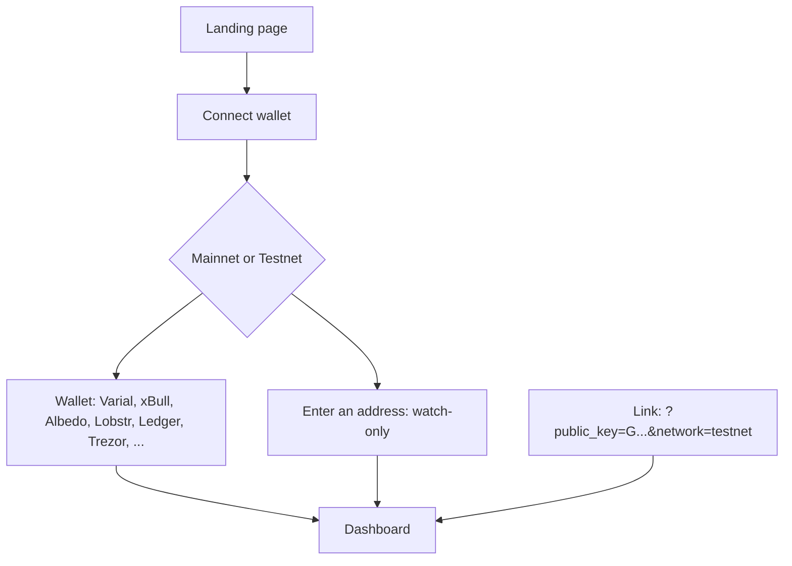
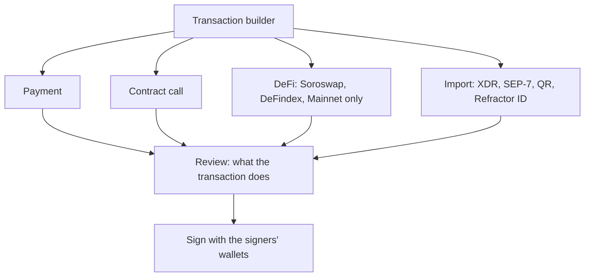
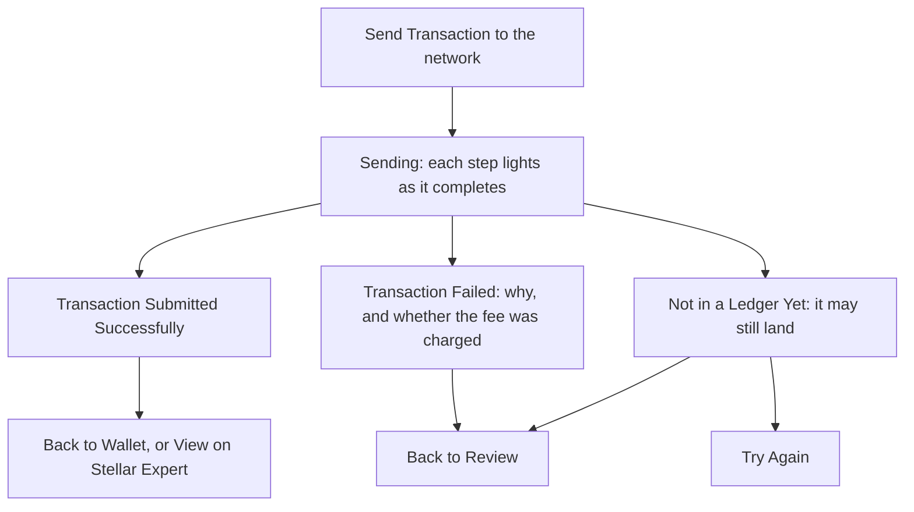

# Stellar Stratum: user flows

How the app is used, screen by screen. Everything works on Mainnet and Testnet; the network is
chosen when connecting and carried by share links and QR codes.

## Connect



A watch-only account can build transactions and collect signatures from other devices; it just
cannot sign itself. A muxed address (M…) opens the account behind it. The URL keeps the account,
network and current view, so any screen can be reloaded or shared.

## Dashboard

- **Balances**: every asset with its issuer, valued with Reflector prices (assets are matched by
  code and issuer, so a look-alike "USDC" is not priced as the real one). On Testnet, XLM and
  Circle's testnet USDC are shown at their Mainnet price.
- **Activity**: payments, swaps, contract transfers and configuration changes, with filters and a
  balance chart. New transactions are picked up on refresh.
- **Multisig**: signers, weights and thresholds, and **Edit Configuration**, which asks first
  (Proceed with Caution) because a wrong change can lock the account. The Multisig tab stays selected
  while editing; it is also the way back.

On a phone the tabs are a bar at the bottom, with **Create** beside them to open the transaction
builder; Endpoints and Disconnect are icons in the header. On a computer the tabs sit under the
account and **Initiate Multisig Transaction** is in the header.

## Build a transaction



- **Payment**: one or more operations in one transaction, with a single transaction memo (text or
  ID). The destination is an account (G…) or a muxed account (M…), whose ID stands in for the memo
  an exchange asks for. A contract (C…) is paid by calling `transfer` on the asset's contract, alone
  in its transaction and without a memo. Unfunded destinations are created, cross-asset payments use Horizon's best
  path within the chosen slippage, and "Merge account" closes the account after emptying its
  trustlines. Everything is checked against the live account when building: trustlines, the minimum
  reserve, memos required by exchanges. A scanned payment request (SEP-7 `pay`) fills the form only
  for the account's network, and only with a text or ID memo; a request without a network is for
  Mainnet.
- **Contract call**: any Soroban contract, including Stellar Asset Contracts. A call that fails in
  simulation, or that needs another address to authorize it, is refused.
- **DeFi**: the transaction returned by the Soroswap or DeFindex API is checked against the request
  (account, contract, amounts, recipient, authorizations) before it can be signed.
- **Import**: a SEP-7 request that leaves parts of the transaction for the signer to fill in
  (`replace`) is refused.
- **Transactions are valid for 24 hours**, so co-signers have time to sign.

Once a transaction is built or imported, the page goes to its review, which comes first; the builder
folds to one row below it and opens again with its chevron. On a phone the screen's main action sits in
a bar at the bottom, and dialogs open from the bottom.

## Review and sign

The review screen shows, before any signature, and above the signing panel:

- each operation in plain words, with its counterparty, amounts, prices, asset issuers and the
  account it acts on when that is not the source; look-alike assets (a "USDC" that is not Circle's,
  a token called "XLM") are flagged;
- what a configuration change does to signers and thresholds, with lockout warnings, including
  signers that are not keys (pre-authorized transactions, hash(x));
- for contract calls, everything the signature authorizes, including nested token transfers;
- the fee in XLM, when the transaction can land (time and ledger bounds, minimum sequence number,
  extra signers) and whether its sequence number fits the account;
- memos with invisible or direction-changing characters made visible;
- the transaction hash for the selected network, to compare with the signing device.


Signatures are counted only when they verify against the transaction, for every account involved
and at the threshold its operations need (for example, high for signer changes and merges).

## Coordinate signatures

```mermaid
flowchart TD
  Signed[Partly signed] --> Mode{How?}
  Mode -->|Online| Refractor[Refractor: share link or QR]
  Mode -->|Offline| Airgap[Air-gap QR]
  Refractor --> CoSigner[Co-signer opens the link on the right network]
  Airgap --> Device[/sign on the offline device]
  CoSigner --> Enough{Weight reached?}
  Device --> Back[Signature QR back to the online device]
  Back --> Enough
  Enough -->|Yes| Submit[Send to the network]
  Enough -->|No| Mode
```

- **Refractor** stores the transaction for both networks; the share link opens it on its network.
  The transaction pulled must have the hash the link names, so Refractor cannot swap it.
- **Air-gapped signing** (`/sign`): open the page, then take the device offline before loading a
  transaction. The page sends nothing itself and blocks scripts from reaching the network, but the
  protection that counts is the device being offline. It reads the network from the QR code,
  shows it, and lets the signer switch it for raw XDR.
- **The QR codes**: a transaction that fits one QR code a phone reads off a screen goes as a SEP-7
  link; a bigger one (contract calls, batches, many signatures) as an animated QR, whose parts the
  scanner reads in any order while it shows its progress. `/sign` answers with a Signature QR that
  holds only the signatures added there; **Scan Signature** in Air-gap Sync adds those that verify
  for a signer of the transaction. The whole signed transaction can go back too, to load in Import.
- A QR code the scanner cannot use (another network, another transaction, another format) is
  explained in the scanner, which keeps scanning.

## Submit



Submission tries the configured Horizon endpoints in turn and checks whether the transaction
already landed before retrying. A result only a third-party mirror reports is labelled as such.
While it runs, a sheet shows the steps the app takes (fee checked, sent to the Horizon, waiting for
a ledger, in the ledger, account updated), with the full log under Details. It ends on the summit:
what happened, the ledger and the fee charged; or on why it failed, in plain language (expired,
sequence already used, not enough signatures, memo required, and so on) and whether a fee was
charged; or, when every Horizon accepted it but it has not landed in time, on a warning that it may
still land, with Try Again.
