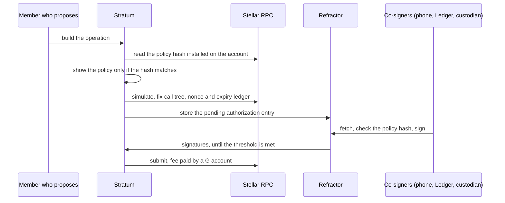

# Stratum architecture

Stratum is a multisig wallet for Stellar. This document describes how it works today, how it will
handle smart (C) accounts, who holds which authority, and how each part is tested. How the app is
used, screen by screen, is in [USER_FLOWS.md](../USER_FLOWS.md).

## Today

Stratum is a React app built with Vite, on stellar-sdk 17 and Stellar Wallets Kit. It runs entirely in
the browser and has no server of its own.

- It builds classic transactions for G accounts: payments, path payments, contract calls, signer and
  threshold changes, and DeFi through Soroswap and DeFindex.
- The review screen explains every operation before anyone signs. A `setOptions` is explained in plain
  language, and a change that would lock the account is refused. For a contract call, the screen shows
  everything the signature authorizes, including nested token transfers. A transaction built by the
  Soroswap or DeFindex API is checked against the request before it can be signed.
- Signatures are counted only when they verify against the transaction, for every account involved and
  at the threshold its operations need.
- Co-signers exchange a partly signed transaction through Refractor or through QR codes. The `/sign`
  page signs on an offline device.
- A call that needs an authorization entry signed by another address is refused. Collecting these
  entries is the first step of the plan below.
- Planned: contract calls described through the draft SEP for contract display descriptors, and a
  warning before paying an address that StellarExpert's public directory flags as malicious or unsafe.

The app is served from Radicle Pages. The host publishes the commit it serves and the hash of every file
in its [manifest](https://consulting-manao.radicle.page/stellar-stratum/.git-pages/manifest.json). The
Content Security Policy is sent as a header from [`public/_headers`](../public/_headers), with
`frame-ancestors 'none'`.

## Accounts

Stratum handles two kinds of shared accounts.

- A G account uses classic multisig: signers with weights, and a threshold per type of operation. The
  protocol defines how signatures are counted, so any wallet can co-sign.
- A C account is a [Perch](https://github.com/stellar-registry/perch) smart account. Its rules are a
  policy document in canonical JSON, identified by its SHA-256 hash. The document says who may call
  which contract and function, with how many signatures, until which ledger and under which spending
  cap. Perch compiles it into OpenZeppelin context rules.

Since protocol 27, CAP-0071 lets a C account delegate its authorization to other accounts inside one
authorization entry. Hence the same Ledger key or passkey can sign for a G account and be a member of a
C account. The members all sign the same payload, which names the C account, so a signature cannot be
reused for another account.

## Signing a C account operation

1. A member builds the operation. Every contract call is decoded from pinned addresses.
2. Stratum reads the policy hash installed on the account and shows the policy only if it matches.
3. Stratum simulates the call and fixes the authorization entry: call tree, nonce and expiry ledger.
4. Each co-signer signs on their device. All the signatures go into the one entry CAP-0071 defines.
5. The transaction waits in Refractor, or travels by link or QR code without it.
6. Once the threshold is met, any co-signer submits the transaction and pays the fee from a G account.

A G account follows the same steps with the transaction hash instead of the authorization entry.

## Members

The C account column describes the plan. Today Stratum signs for G accounts only.

| Member | G account | C account |
|---|---|---|
| Ledger | Through Stellar Wallets Kit | Directly, Stellar app 6.1.0 or later |
| Other wallets | Through Stellar Wallets Kit, as the kit adds them | Only if the wallet signs CAP-0071 entries |
| Passkey | ghostsig, a G key derived from the passkey (SEP-52) | Perch's WebAuthn verifier, or ghostsig as a delegated G key |
| Custodian vault (Fordefi first) | As a classic signer | If the custodian signs entries for a delegated member |
| ML-DSA-65 key | Not possible | Perch's ML-DSA-65 verifier, key on an offline device |
| Smart account (a Nido wallet) | Not possible | As a delegated member, through CAP-0071 |

ML-DSA has no authenticator yet. The key lives on an offline device, which signs with
`@noble/post-quantum` and answers with a sequence of QR codes, since a signature is 3,309 bytes. Since
protocol 30, Stellar verifies ML-DSA natively (CAP-0087), with the same context string Perch's
verifier uses, so members keep their keys. Where the host function is not available, Perch's verifier
runs in the contract for 95.0M instructions, 23.8% of the transaction limit.

## Recovery

- A member who loses a passkey restores the key from SLIP-39 shares made by ghostsig.
- The quorum replaces a lost member with a normal policy change.
- If too many members are lost, Perch's recovery controller recovers a C account with guardians, a
  zero-knowledge proof, or both, after a delay. Under the `Loss` profile the account keeps working and
  the quorum can veto an attempt. Under `Protected` the account freezes while an attempt is authorized,
  and only the recovery evidence can cancel it.

## DeFi from a shared account

A swap quote expires long before three people have signed, so a policy can let one operator swap alone.
A swap from a C account authorizes two calls, the router call and the token transfer inside it, so the
operator gets two rules. The router rule allows the swap functions with the account as recipient, and
the token rule carries the spending cap. From a G account, swaps route through Soroswap, Aquarius,
Phoenix, Sushi and SDEX. From a C account they use Soroban pools only, since an SDEX leg is a classic
path payment that a C account cannot send.

## Refractor and custodians

Refractor stores a partly signed transaction until its threshold is met or it expires, verifies each
signature and cannot change the transaction, since a link names its hash. It merges the signatures of a
G transaction. On a C account, each member's signature goes inside the authorization entry and changes
the transaction hash, which Refractor keys on, so we add support for authorization entries to Refractor,
which is open source. Until that change is deployed, a C entry travels by link or QR code. Custodians
connect through an interface modelled on Ripple's simpleXRPL, with Fordefi as the first implementation.

## Privacy

Stratum keeps no data about its users and runs no server of its own. There is no account, no analytics
and no telemetry. Every outside service the app calls is listed in the [privacy
policy](https://stellar-stratum.xyz/legal/privacy). The directory lookup sends StellarExpert the
destination of a payment and nothing else, on mainnet only and never from the air-gapped signer, and a
failed lookup changes nothing.

## Who holds which authority

| Party | Can | Cannot |
|---|---|---|
| Members (quorum) | Approve operations within the policy, change the policy, enroll recovery | Act alone above the threshold a rule requires |
| An operator on a DeFi rule | Swap alone, to the account, within its cap | Send the output elsewhere, exceed the cap |
| Guardians | Approve a recovery statement | Move funds, change the policy outside recovery |
| Refractor | Store a partly signed transaction and collect signatures | Change it, since the link names its hash |
| Custodian | Sign as one member | Sign for the others |
| Perch's WebAuthn and ML-DSA verifiers | Check a signature | Nothing else: they have no admin |

## Contracts

Stratum adds no contract of its own. It uses Perch's stack, deployed on testnet and, as a beta, on
mainnet since 26 October 2026. The addresses and wasm hashes are in Perch's manifests,
[testnet](https://github.com/stellar-registry/perch/blob/main/deployments/testnet.json) and
[mainnet](https://github.com/stellar-registry/perch/blob/main/deployments/mainnet.json), which
`scripts/verify-deployment.sh` checks against the chain.

| Contract | Role |
|---|---|
| `perch-account`, `perch-account-factory` | The C account, deployed by the factory with its admin signers |
| `perch-doc-compiler`, `perch-interpreter` | Turn the policy document into rules, and evaluate what stock policies cannot |
| `perch-spending-limit` | Cumulative caps |
| `perch-ed25519-verifier`, `perch-webauthn-verifier` | Ed25519 and passkey members |
| `perch-mldsa-verifier` | ML-DSA-65 members, released, on mainnet after the audit |
| `perch-recovery`, `perch-zk-pool`, `perch-zk-adapter` | Recovery with guardians or a zero-knowledge proof |

Perch's audit goes through the Audit Bank, with the scope in
[docs/audit-scope.md](https://github.com/stellar-registry/perch/blob/main/docs/audit-scope.md). Until it
is published, C accounts on mainnet use only rules that lower to stock OpenZeppelin policies.

## What is built and what is reused

| Built in Stratum | Reused |
|---|---|
| Collecting and counting CAP-0071 entries for a quorum | Perch: policy document, compiler, contracts, TypeScript packages |
| Co-signer onboarding by link and passkey | ghostsig, in Stellar Wallets Kit since 2.7.0 |
| Policy view, diff and hash check, templates | Nido's passkey SDK |
| Offline ML-DSA signer with QR sequences | The Soroswap and DeFindex integration |
| Migration of a G multisig to a C quorum, quantum report | Refractor for G transactions |
| Recovery screens for shared accounts | |
| DeFi from C accounts with an operator rule | |
| Authorization entries in Refractor, custodian interface | |
| Directory warnings and contract display descriptors | |
| A SEP draft for multisig on C accounts | |

## Tests

- Unit tests run in CI on every push: typecheck, lint, Vitest and the build.
- End-to-end tests run on testnet with Playwright, on throwaway accounts funded by friendbot. Any
  request to a mainnet endpoint fails the test. They cover a payment signed outside the app, the
  sequence check, a 2-of-2 multisig where one signature is not enough, a Refractor link and the
  air-gapped signer.
- New flows come with negative tests: a key outside the quorum is refused, a tampered or outdated policy
  is refused before signing, a member removed after approving no longer counts, an expired entry is
  refused before submission, and a lock-out `setOptions` is refused.
- The offline ML-DSA signer passes the NIST ACVP ML-DSA-65 key generation and signing vectors in CI.

## Limits

- The transaction is still paid and signed with Ed25519 by a G account. Only the authorization of a C
  account can be post-quantum today.
- Perch binds a policy change to the revision it replaces, but not yet an ordinary approval. A rule
  edited in place between signing and inclusion applies to the pending operation. Stratum checks the
  policy hash on every device and keeps signature expirations short.
- Perch policies govern C accounts only. Moving from G to C changes the address, so it stays optional.
- ghostsig is beta software and has not been audited. In a quorum its key is one signer among several.
